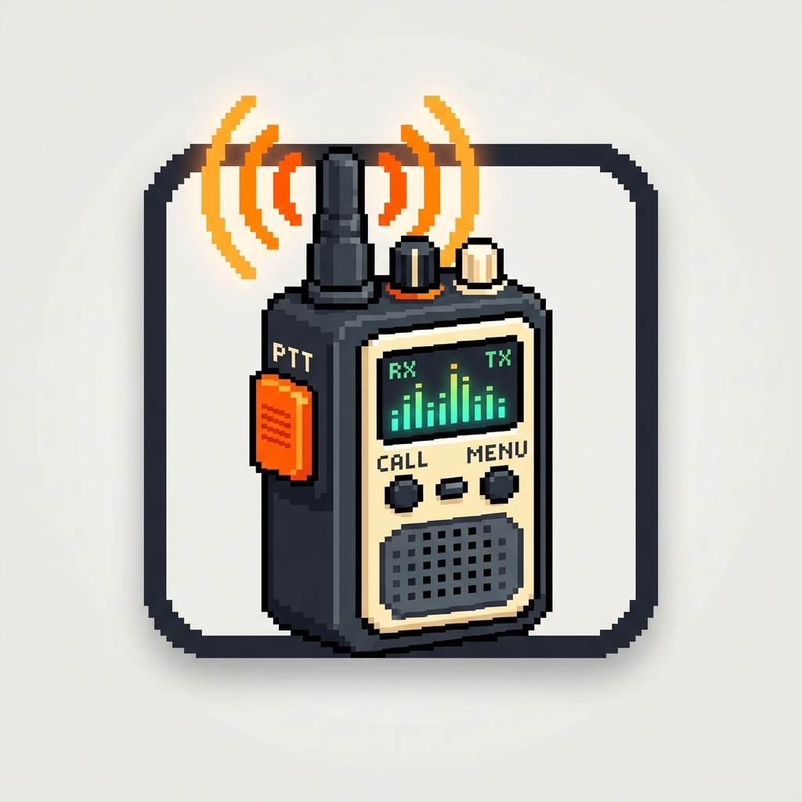

#  walkie

Talk with your coding agent. Runs entirely on your machine, powered by
[NVIDIA NeMo-Speech.cpp](https://github.com/NVIDIA/NeMo-Speech.cpp): MagpieTTS for speech
and Nemotron 3.5 for recognition.

- **It speaks** one short sentence when a task finishes, when it is blocked, or when it
  needs an answer, and stays quiet otherwise.
- **It listens** for your answer when it has asked you something.
- **`/walkie:talk`** turns what you say into your next prompt.
- **`/walkie:converse`** makes the rest of the session a spoken conversation.

Nothing you say or hear leaves your machine.

walkie is the add-on to [voicebox](https://github.com/danilogr/voicebox), which
transcribes recordings, writes voice-overs and reads long text aloud. Installed together
they share one speech server and one copy of the models, and take turns at the speakers.

## Install

In Claude Code:

    /plugin marketplace add danilogr/voicebox
    /plugin install walkie@voicebox-marketplace

walkie needs [uv](https://docs.astral.sh/uv/), which launches it; if `uv` is not on the
`PATH` or in a standard location, set `WALKIE_UV` (used by the launchers) to its full path.

Restart Claude Code. walkie speaks at once through the macOS `say` voice. Run
`/walkie:setup` once for the neural voice and for listening: it installs NeMo-Speech.cpp
and its two models (about 1.4 GB) and shows walkie's one-time telemetry notice. Then set
`WALKIE_ENGINE=nemo` for the neural voice. walkie works under Antigravity too, as an MCP
server; `/walkie:converse` is offered there as the `converse` prompt.

## Speaking

The `speak` tool's own description tells the agent when a voice beats scrollback: a
finished task, a blocker, a question, and a one-line recap at the end of a substantial
turn. It never reads code, paths or long output aloud. Sentences queue and play in order
without overlapping, and the next one is synthesized while one plays. While the speech
server is still starting, a sentence is spoken by `say` rather than lost.

## Listening

- **`listen`** — after asking you something out loud, the agent opens the microphone,
  records until you stop talking, and reads the transcript.
- **`/walkie:talk`** — say your next prompt instead of typing it.
- **`/walkie:converse`** — for the rest of the session the agent speaks its answers and
  listens for yours whenever it needs input. Say "stop" to go back to text.

A chime says the microphone is open and another that it has shut; recording stops after
three seconds of silence. One session records at a time. While the microphone is open
walkie holds the speakers: a sentence already playing finishes first, and nothing else —
voicebox reading aloud, or walkie's own next sentence — plays until the recording ends.
The transcript comes from a small on-device model and may contain misheard words, so the
agent confirms before anything destructive.

## Tools and commands

| Tool | What it does |
|---|---|
| `speak(text, voice?, rate?, intent?)` | Queues one short sentence to be spoken |
| `listen(max_seconds?)` | Records your answer and returns the transcript |
| `list_voices()` | The voices the current engine has, and which one is active |
| `set_voice(voice)` | Changes the voice for this session |
| `speech_status()` | What the speech queue is holding |
| `stop_speaking()` | Stops talking at once and drops what is queued |

| Command | What it does |
|---|---|
| `/walkie:talk` | Speak your next prompt instead of typing it |
| `/walkie:converse` | Talk with the agent for the rest of the session |
| `/walkie:setup` | Install NeMo-Speech.cpp and the models |
| `/walkie:telemetry [on\|local\|off\|--id\|notice\|record on\|record off]` | Show or change the telemetry setting |
| `/walkie:stats` | What walkie has recorded about your own use |

## Settings

Environment variables, read when the server starts:

| Setting | Default | |
|---|---|---|
| `WALKIE_ENGINE` | `say` | `say` (macOS), `nemo` (the neural voice) or `command` |
| `WALKIE_VOICE` | engine default | a voice name, or `random` for a new one each session |
| `WALKIE_VOICE_POOL` | the engine's pool | comma-separated voices `random` draws from |
| `WALKIE_RATE` | engine default | words per minute, for engines that take one |
| `WALKIE_MAX_CHARS` | `400` | longest sentence spoken, cut at a word |
| `WALKIE_COMMAND` | unset | the program `WALKIE_ENGINE=command` runs, with the sentence as its last argument |
| `WALKIE_INPUT_DEVICE` | system default | the microphone to record from, by name |
| `WALKIE_LISTEN_SILENCE_MS` | `3000` | silence that ends a recording |
| `WALKIE_LISTEN_MAX_SECONDS` | `240` | longest recording |
| `WALKIE_LISTEN_TIMEOUT` | `10` | seconds to wait for you to start talking |
| `WALKIE_LISTEN_LANGUAGE` | detected | language code of what you say, e.g. `en` |
| `WALKIE_LISTEN_CUE` | `1` | `0` to mute the microphone chimes |
| `WALKIE_LISTEN_CUE_START`, `_END`, `_EMPTY` | built-in sounds | your own chime files |
| `WALKIE_UV` | found on `PATH` or in a standard location | full path to `uv`, used by the launchers |
| `WALKIE_STATE_DIR` | `~/Library/Caches/walkie` | the microphone lock and the local telemetry store |
| `NEMO_HTTP_URL` | `http://127.0.0.1:8082` | the shared speech server |
| `NEMO_API_KEY` | unset | sent to the speech server when it needs one |
| `NEMO_BIN` | `nemo-speech` | the server binary, when it is not on `PATH` |
| `NEMO_AUTOSTART` | `1` | `0` to run the speech server yourself |
| `NEMO_TTS_SEED` | unset | pins each voice's timbre across server restarts |

`NEMO_*` settings are shared with voicebox: whichever plugin starts the speech server
decides its arguments for both, so keep them identical.

## Privacy and telemetry

Audio, transcripts and what the agent says never leave your machine. walkie reports
anonymous usage data — which features are used, how long speech and listening take on
which hardware, and why they fail — once you have seen its notice.
`/walkie:telemetry off` stops it (an anonymous install count is still sent);
`DO_NOT_TRACK=1` stops everything. Every field is listed in [TELEMETRY.md](TELEMETRY.md).

## Voice tuning

[voice-tuning/](voice-tuning/README.md) records a personal dataset on your own microphone
and fine-tunes the recognition model on your voice.

## Development

    uv sync
    uv run pytest
    uv run ruff check .
    uv run mypy
    scripts/install-local.sh    # copy this checkout over the installed plugin; restart Claude Code

The speech engine is [speak-core](https://github.com/danilogr/speak-core), a git
dependency. Operating rules are in [AGENTS.md](AGENTS.md); design in
[harness/architecture.md](harness/architecture.md), flows in
[harness/user-flow.md](harness/user-flow.md), measurements in
[harness/performance.md](harness/performance.md), conventions in
[harness/design-guidelines.md](harness/design-guidelines.md), the file map in
[harness/layout.md](harness/layout.md), and building the speech stack into another agent
in [harness/integration.md](harness/integration.md).
